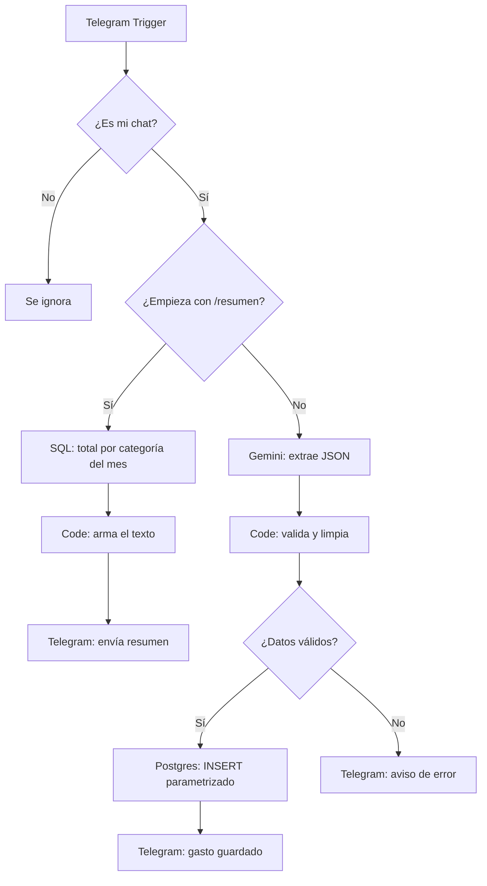
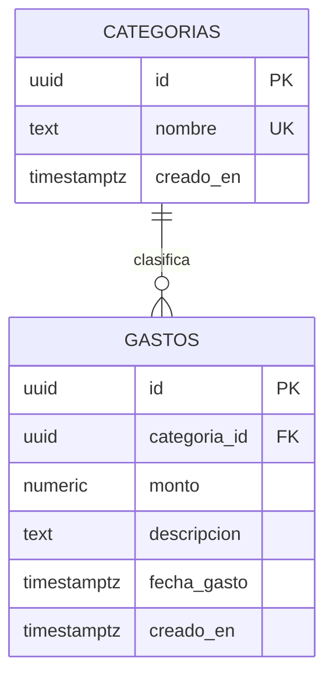

# 💸 Control de Gastos por Telegram

Bot de Telegram que registra gastos a partir de mensajes en lenguaje natural (por ejemplo, `almuerzo 3.50`), los valida y los guarda en una base de datos **PostgreSQL (Supabase)**. También responde con un resumen mensual por categoría.

Proyecto de portafolio enfocado en **modelado de datos, validación defensiva, migraciones versionadas y seguridad básica**.

> Los textos marcados con `TODO` son espacios para completar con tus datos (nombre, enlaces, capturas).

---

## 📌 Contenido

- [Qué hace](#-qué-hace)
- [Arquitectura](#-arquitectura)
- [Tecnologías](#-tecnologías)
- [Modelo de datos](#-modelo-de-datos)
- [Validaciones](#-validaciones)
- [Seguridad](#-seguridad)
- [Comandos del bot](#-comandos-del-bot)
- [Estructura del repositorio](#-estructura-del-repositorio)
- [Cómo ejecutarlo](#-cómo-ejecutarlo)
- [Pruebas realizadas](#-pruebas-realizadas)
- [Limitaciones conocidas](#-limitaciones-conocidas)
- [Mejoras futuras](#-mejoras-futuras)
- [Autor](#-autor)

---

## ✨ Qué hace

1. Recibes un mensaje en Telegram: `almuerzo 3.50`.
2. Un modelo de IA (**Gemini**) extrae un JSON con `monto`, `descripcion` y `categoria`.
3. Un nodo de código **valida** esos datos sin confiar ciegamente en la IA.
4. Si todo es correcto, se guarda en PostgreSQL con una consulta **parametrizada**.
5. El bot confirma el gasto guardado, o avisa si no pudo entender el mensaje.
6. Con `/resumen` obtienes el total del mes por categoría.

**TODO:** agrega aquí una captura de la conversación con el bot.

```
docs/capturas/bot.png
```

---

## 🏗 Arquitectura



**TODO:** agrega una captura del flujo completo en n8n.

```
docs/capturas/flujo-n8n.png
```

---

## 🛠 Tecnologías

| Capa | Herramienta |
|------|-------------|
| Interfaz | Telegram Bot API |
| Automatización | n8n (Community Edition, autoalojado con Docker) |
| IA | Google Gemini (extracción a JSON) |
| Base de datos | PostgreSQL en Supabase |
| Túnel público | ngrok (para que Telegram alcance el `localhost`) |
| Control de versiones | Git y GitHub |

---

## 🗄 Modelo de datos



Decisiones de diseño:

- **`NUMERIC(12,2)`** para dinero, para evitar errores de redondeo de los tipos flotantes.
- **`TIMESTAMPTZ`** para las fechas, y la zona horaria de Ecuador (`America/Guayaquil`) en los reportes.
- **Llave foránea** `gastos.categoria_id → categorias.id`, que impide guardar un gasto en una categoría inexistente.
- **`CHECK (monto > 0)`**: la base rechaza montos negativos o cero aunque falle la validación de la aplicación.
- **Índices** en `fecha_gasto` y `categoria_id`, las columnas que se usan en los reportes.

### Migraciones

Los scripts están en `migrations/` y se ejecutan en orden:

- `001_crear_tablas.sql`: tablas, índices y categorías iniciales.
- `002_rls_y_seguridad.sql`: activa Row Level Security.

### Reportes

`queries/reportes.sql` contiene las consultas de análisis, por ejemplo el total por categoría y mes:

```sql
SELECT c.nombre AS categoria,
       date_trunc('month', g.fecha_gasto) AS mes,
       SUM(g.monto) AS total
FROM gastos g
JOIN categorias c ON c.id = g.categoria_id
GROUP BY c.nombre, mes
ORDER BY mes DESC, total DESC;
```

---

## ✅ Validaciones

La salida de la IA **no se considera confiable**. Antes de guardar, el flujo comprueba:

- Que la respuesta sea un JSON válido (se limpian bloques de markdown).
- Que el monto sea numérico, mayor que 0 y menor que un límite razonable.
- Que el **monto devuelto por la IA aparezca realmente en el mensaje original**.
- Que el mensaje original **no contenga un número negativo**.
- Que la descripción no esté vacía (se limita a 200 caracteres).
- Que la categoría pertenezca a la lista permitida; si no, se usa `Otros`.

### 🔎 Hallazgo durante las pruebas

Al probar el mensaje `-5 pizza`, el modelo interpretó el monto como `5` y el gasto se guardó, porque el JSON que devolvió era válido. La validación original solo revisaba la salida de la IA.

**Corrección:** se agregó una verificación cruzada contra el texto original del usuario (rechaza negativos y montos que no aparecen en el mensaje). Además, la restricción `CHECK` de la base sigue funcionando como última barrera.

> Moraleja: una validación en un solo punto no basta; conviene validar en varias capas.

---

## 🔒 Seguridad

- **Consultas parametrizadas** (`$1`, `$2`, `$3`): el texto del usuario nunca se concatena en el SQL, lo que evita inyección SQL.
- **Row Level Security (RLS)** activado en las tablas: la API pública de Supabase no puede leerlas ni modificarlas.
- **Restricción por chat ID:** el flujo ignora los mensajes de cualquier cuenta que no sea la del propietario.
- **Credenciales fuera del repositorio:** los tokens y contraseñas viven en las credenciales de n8n, y el archivo `flujo.json` exportado no incluye sus valores.
- El chat ID del flujo exportado debe reemplazarse por `TU_CHAT_ID` antes de publicarlo.

---

## 💬 Comandos del bot

| Mensaje | Resultado |
|---------|-----------|
| `almuerzo 3.50` | Guarda el gasto y confirma monto, categoría y descripción |
| `/resumen` | Total del mes por categoría y total general |
| Cualquier texto que no sea un gasto | Aviso de que no se entendió el mensaje |

Ejemplo de respuesta a `/resumen`:

```
📊 Resumen del mes
• Estudios: $12.00
• Comida: $9.20
• Ocio: $8.00

💰 Total: $29.20
```

---

## 📁 Estructura del repositorio

```
control-gastos/
├── README.md
├── migrations/
│   ├── 001_crear_tablas.sql
│   └── 002_rls_y_seguridad.sql
├── queries/
│   └── reportes.sql
├── n8n/
│   └── flujo.json
├── docs/
│   └── capturas/
└── .gitignore
```

---

## 🚀 Cómo ejecutarlo

### Requisitos

- Docker Desktop
- Cuenta en Supabase
- Cuenta en ngrok
- Un bot de Telegram (creado con @BotFather)
- Una API key de Google AI Studio (Gemini)

### 1. Base de datos

1. Crea un proyecto en Supabase.
2. En el **SQL Editor**, ejecuta en orden los archivos de `migrations/`.

### 2. Túnel público

Telegram solo envía mensajes a direcciones públicas con HTTPS, así que se expone el puerto de n8n con ngrok:

```bash
ngrok http 5678 --url https://TU-DOMINIO.ngrok-free.dev
```

### 3. n8n con Docker

```bash
docker volume create n8n_data

docker run -d --name n8n --restart unless-stopped \
  -p 5678:5678 \
  -e WEBHOOK_URL=https://TU-DOMINIO.ngrok-free.dev/ \
  -e GENERIC_TIMEZONE=America/Guayaquil \
  -e TZ=America/Guayaquil \
  -v n8n_data:/home/node/.n8n \
  docker.n8n.io/n8nio/n8n
```

### 4. Importar el flujo y crear credenciales

1. Abre `http://localhost:5678` y crea tu usuario.
2. Importa `n8n/flujo.json` (menú `...` → *Import from File*).
3. Crea las credenciales:
   - **Telegram:** el token de tu bot.
   - **Postgres:** datos del *Session pooler* de Supabase (el usuario tiene el formato `postgres.TUPROYECTO`) con SSL activado.
   - **Google Gemini:** tu API key.
4. En el nodo `Solo yo`, reemplaza `TU_CHAT_ID` por tu chat ID de Telegram.
5. Pulsa **Publish**.

> El bot solo responde mientras Docker y ngrok estén ejecutándose en tu equipo.

---

## 🧪 Pruebas realizadas

| Entrada | Resultado esperado | Estado |
|---------|--------------------|--------|
| `almuerzo 3.50` | Se guarda y se confirma | ✅ |
| `café 1,25` | Se guarda como 1.25 | TODO: confirmar |
| `-5 pizza` | Se rechaza | ✅ (tras la corrección) |
| `hola` | Aviso de error, no se guarda | ✅ |
| `/resumen` | Resumen del mes | ✅ |
| Mensaje desde otra cuenta | Se ignora | TODO: confirmar |

---

## ⚠️ Limitaciones conocidas

- Solo reconoce montos escritos con **dígitos** (`tres dólares` se rechaza a propósito, por seguridad).
- Pensado para **un solo usuario**: no hay tabla de usuarios ni separación de datos.
- Depende de que el equipo local, Docker y ngrok estén activos.
- Las categorías son fijas y se asignan por interpretación de la IA, que puede equivocarse.

---

## 🔮 Mejoras futuras

- [ ] Soporte multiusuario (tabla `usuarios` y gastos asociados a cada uno).
- [ ] Comandos `/semana`, `/ultimos` y `/categoria`.
- [ ] Dashboard con Metabase conectado a PostgreSQL.
- [ ] Migraciones automáticas con Flyway o Liquibase.
- [ ] Pruebas automatizadas y pipeline de CI con GitHub Actions.
- [ ] Despliegue en un servidor para no depender del equipo local.
- [ ] Edición y eliminación de gastos desde el bot.

---

## 👤 Autor

**TODO: tu nombre**
Quito, Ecuador
[LinkedIn](https://www.linkedin.com/) · [GitHub](https://github.com/)
